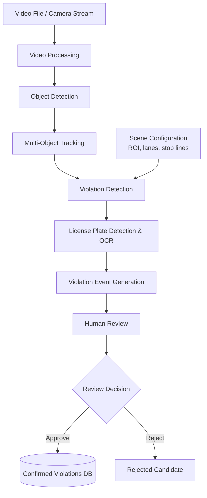

# Traffic Violation Detection System

An AI-assisted traffic violation detection system that analyzes road surveillance videos, identifies potential violations, extracts supporting evidence, and presents cases for human review before a final decision is recorded.

> **Project status:** Early development — Phase 1 (baseline). Notebooks 00 (environment & dataset) and 01 (video reading) are done locally; next is refactoring the validated video reader into `src/`, then **Notebook 02 — Object Detection** on a GPU server.
>
> **Academic scope:** This is a specialized academic project and an environment for practicing Computer Vision, AI Engineering, and MLOps. It is not an automated traffic enforcement authority.

The full project baseline — objectives, notebook roadmap, data contracts, and definition of done — is in [`docs/project_specification.md`](docs/project_specification.md).

## Objectives

- Process traffic videos from recorded files first, with support for camera streams considered later.
- Detect and track road users across video frames.
- Identify **potential** traffic violations from object trajectories and scene-specific rules.
- Recognize license plates where the footage quality allows it.
- Store violation candidates, timestamps, and visual evidence for review.
- Provide a simple human-review interface to approve or reject candidates.
- Evaluate a pretrained-model baseline, then fine-tune selected models and compare results.

## System Overview



Violation detection uses explicit, scene-specific rules (such as red-light running, wrong-way driving, or lane violations) evaluated against tracked trajectories and a scene configuration. Detection results are **candidates** with status `pending`, never final judgments: a violation is confirmed only by human review.

## Development Plan

### Phase 1 — End-to-End Baseline

Build a working end-to-end pipeline with pretrained models and simple, explainable rules. Training custom models is not required in this phase. Each component is explored in its own notebook, in order:

| # | Notebook | Purpose | Status |
| --- | --- | --- | --- |
| 00 | `00_environment_and_dataset.ipynb` | Reproducible environment; inspect the sample videos | Done locally (GPU-server re-run pending) |
| 01 | `01_video_reading.ipynb` | Video representation, metadata, frame access with OpenCV | Done locally (GPU-server re-run pending) |
| 02 | `02_object_detection.ipynb` | Pretrained detector, structured detections | Planned |
| 03 | `03_multi_object_tracking.ipynb` | Track IDs and per-vehicle trajectories (e.g. ByteTrack) | Planned |
| 04 | `04_traffic_scene_configuration.ipynb` | ROI, lanes, stop lines, directions as machine-readable config | Planned |
| 05 | `05_violation_detection.ipynb` | One feasible violation type as an explicit, testable rule | Planned |
| 06 | `06_license_plate_recognition.ipynb` | Plate localization + OCR, with explicit unknown/unreadable state | Planned |
| 07 | `07_violation_event_generation.ipynb` | Event schema, evidence, `pending` review status, deduplication | Planned |
| 08 | `08_end_to_end_baseline.ipynb` | Full pipeline on a video, simulated review, performance summary | Planned |
| 09 | `09_baseline_evaluation.ipynb` | Measured quality, error analysis, Phase 2 priorities | Planned |

### Phase 2 — Model Training & Optimization

Building on Phase 1 evidence:

1. Collect or select appropriately licensed, representative datasets, then annotate them.
2. Fine-tune detection, tracking, or plate recognition where the baseline is measurably insufficient.
3. Compare trained components against the baseline on the same held-out test data.
4. Introduce MLOps practices: dataset/model versioning, experiment tracking, deployment, and monitoring.

## Development Approach: Notebook First

**Understand → Implement → Visualize → Evaluate → Validate → Refactor**

1. Explore one component per notebook, with small incremental cells.
2. Visualize intermediate results and measure behavior.
3. Record observations, limitations, and decisions in the notebook itself.
4. Only after validation, move reusable logic into `src/traffic_violation_detection/` and add tests under `tests/`.

Every notebook must run top to bottom from a clean kernel. Data shared between notebooks goes through documented files under `configs/` or `outputs/`, or through validated modules in `src/` — never through leftover kernel state.

## Repository Structure

```text
traffic-violation-detection-system/
├── README.md
├── pyproject.toml          # Python package + dependencies
├── environment.yml         # Conda environment (Python version)
├── docs/
│   └── project_specification.md
├── notebooks/              # 00–09 experiment notebooks
├── configs/                # Scene and experiment configuration (from Notebook 04)
├── data/                   # Input videos (small test clips are committed)
├── outputs/                # Generated frames, videos, evidence, events, evaluations (git-ignored)
├── src/
│   └── traffic_violation_detection/   # Validated reusable modules
└── tests/
```

Generated outputs, model weights, and raw footage under `data/raw/` are git-ignored. Only the small test clips directly under `data/` are committed.

## Getting Started

Requirements: [Conda](https://docs.conda.io/) (Miniconda is enough). The environment uses Python 3.11.

```bash
git clone <your-repository-url>
cd traffic-violation-detection-system

conda env create -f environment.yml
conda activate tvd
pip install -e ".[notebooks]"

# Register the environment as a Jupyter kernel
python -m ipykernel install --user --name tvd --display-name "Python (tvd)"

jupyter notebook notebooks/
```

Open `notebooks/00_environment_and_dataset.ipynb` and select the **Python (tvd)** kernel.

### Running on a GPU server

Notebooks 00–01 (video reading) run on CPU. Object detection (Notebook 02 onward) is intended to run on a rented GPU server:

1. Clone the repository on the server — the committed test clips in `data/` come with it.
2. Create the same conda environment with the commands above.
3. PyTorch and the detector package are added in Notebook 02, because the correct PyTorch build depends on the server's CUDA version (check it with `nvidia-smi`).

Notebook 00 records the Python version, package versions, and GPU availability of whichever machine runs it.

## Sample Data

| File | Format (verified in Notebook 00) | Content | Role |
| --- | --- | --- | --- |
| `data/video-test.mp4` | H.264, 1920×1080, 59.94 FPS, 900 frames (15.0 s) | Dense urban two-way street (motorcycles, cars, buses) with a distant traffic signal that turns red → green; **camera drifts by up to ≈110 px** | Primary sample for the baseline |
| `data/traffic_sample.mp4` | MPEG-4 Part 2 (`FMP4`), 640×360, 24 FPS, 240 frames (10.0 s) | Synthetic top-down intersection with a traffic light; frame number and timestamp burned in | Ground truth for frame/timestamp checks (Notebook 01); rule-logic tests |
| `data/car-detection.mp4` | H.264, 768×432, 12.5 FPS, 377 frames (30.2 s) | Overhead view of asphalt; cars pass intermittently | Detector/tracker sanity checks |

Details, observations, and a suitability assessment per violation type are in Notebook 00. Use only videos you are permitted to use.

## Candidate Technologies

| Area | Initial direction |
| --- | --- |
| Language | Python 3.11 |
| Environment | Conda + pip (`pyproject.toml`) |
| Video processing | OpenCV, FFmpeg (when needed) |
| Object detection | Pretrained YOLO-family model (to be selected in Notebook 02) |
| Multi-object tracking | ByteTrack or BoT-SORT (to be evaluated in Notebook 03) |
| Violation detection | Rule-based logic using tracked trajectories and scene configuration |
| License plate recognition | Plate detection + OCR (to be evaluated in Notebook 06) |
| API/backend | FastAPI (planned) |
| Database | PostgreSQL (planned) |
| Review interface | Minimal web UI (planned) |
| Experimentation | Jupyter Notebook |
| Cloud/MLOps | GPU server for inference; AWS and MLOps tools (future extension) |

These are working candidates, not final technology decisions.

## Evaluation

The baseline and fine-tuned system will be evaluated at both component and system levels:

- **Object detection:** precision, recall, and mAP.
- **Tracking:** ID stability, ID switches, and appropriate MOT metrics.
- **License plate recognition:** character/plate-level accuracy on legible plates.
- **Violation detection:** event-level precision and recall, false positives/negatives.
- **End-to-end pipeline:** processing throughput, latency, and evidence completeness.

Dataset quality, camera placement, traffic-rule definitions, and test methodology will be documented to make results reproducible.

## Responsible Use

- Treat automated detections as **reviewable alerts**, not legally binding conclusions.
- Require human verification before confirming a violation.
- Minimize access to footage and personally identifiable data, including license plates.
- Use videos and datasets only when collection, usage, and retention are authorized.
- Expect errors caused by occlusion, lighting, weather, camera angle, and OCR uncertainty.

## Current Milestone

**Phase 1 / Notebook 02: Object Detection** (next)

Before starting:

- [ ] Move the validated video-reading functions from Notebook 01 into `src/traffic_violation_detection/` with `pytest` tests.
- [ ] Set up the conda environment on the GPU server and re-run Notebooks 00–01 there.

Notebook 01 is complete on the development machine:

- [x] Video metadata (FPS, frame count, resolution, duration) read and explained.
- [x] Frame pixel data inspected; BGR → RGB conversion demonstrated.
- [x] Sequential, stepped, and random access (by frame index and by timestamp) verified frame-by-frame against reference hashes on all three clips.
- [x] End-of-video, invalid files (missing, non-video, empty, truncated), and resource cleanup handled and tested.

Notebook 00 is complete on the development machine:

- [x] Reproducible conda environment with documented Python and package versions.
- [x] Project paths for input videos and experiment outputs.
- [x] Sample videos load reliably; format, resolution, FPS, and duration verified by full decoding.
- [x] Visible objects and traffic behaviors documented.
- [x] Suitability of the footage for violation detection assessed (preliminary).
- [x] Environmental assumptions and limitations documented.
- [ ] Re-run Notebook 00 on the GPU server.

## License

Released under the [MIT License](LICENSE).
