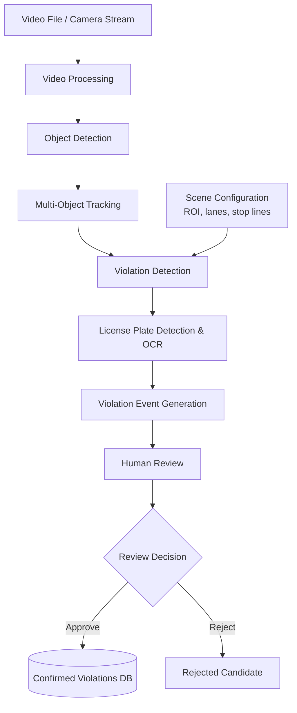

# Traffic Violation Detection System

An AI-assisted traffic violation detection system that analyzes road surveillance videos, identifies potential violations, extracts supporting evidence, and presents cases for human review before a final decision is recorded.

> **Project status:** Early development — Phase 1 (baseline). Notebooks 00–06 and 05b (environment & dataset, video reading, object detection, multi-object tracking, scene configuration, wrong-way and red-light violation rules, license plate recognition) are done and verified on the GPU server; validated reusable code lives in `src/traffic_violation_detection/` (`video.py`, `detection.py`, `tracking.py`, `camera.py`, `scene.py`, `wrong_way.py`, `red_light.py`, `evidence.py`, `plates.py`, `plate_worker.py`). Next: **Notebook 07 — Violation Event Generation**.
>
> **Academic scope:** This is a specialized academic project and an environment for practicing Computer Vision, AI Engineering, and MLOps. It is not an automated traffic enforcement authority.

The full project baseline — objectives, notebook roadmap, data contracts, and definition of done — is in [`docs/project_specification.md`](docs/project_specification.md).

## Objectives

- Process traffic videos from recorded files first, with support for camera streams considered later.
- Detect and track road users across video frames.
- Identify **potential** traffic violations from object trajectories and scene-specific rules.
- Recognize license plates where the footage quality allows it.
- Store violation candidates, timestamps, and visual evidence for review.
- Provide a simple human-review interface to approve or reject candidates.
- Evaluate a pretrained-model baseline, then fine-tune selected models and compare results.

## System Overview



Violation detection uses explicit, scene-specific rules (such as red-light running, wrong-way driving, or lane violations) evaluated against tracked trajectories and a scene configuration. Detection results are **candidates** with status `pending`, never final judgments: a violation is confirmed only by human review.

## Development Plan

### Phase 1 — End-to-End Baseline

Build a working end-to-end pipeline with pretrained models and simple, explainable rules. Training custom models is not required in this phase. Each component is explored in its own notebook, in order:

| # | Notebook | Purpose | Status |
| --- | --- | --- | --- |
| 00 | `00_environment_and_dataset.ipynb` | Reproducible environment; inspect the sample videos | Done (verified locally and on the GPU server) |
| 01 | `01_video_reading.ipynb` | Video representation, metadata, frame access with OpenCV | Done (verified locally and on the GPU server) |
| 02 | `02_object_detection.ipynb` | Pretrained detector, structured detections, and a video with its boxes drawn | Done (GPU server) |
| 03 | `03_multi_object_tracking.ipynb` | Track IDs and per-vehicle trajectories; ByteTrack vs OC-SORT vs BoT-SORT | Done (GPU server) |
| 04 | `04_traffic_scene_configuration.ipynb` | Camera registration; regions, lines, directions and signal as machine-readable config | Done (GPU server) |
| 05 | `05_violation_detection.ipynb` | Wrong-way driving as an explicit, testable rule; no real violation found in the clip | Done (GPU server) |
| 05b | `05b_red_light_violation.ipynb` | Red-light rule, frozen before evaluation, with precision and recall on labelled clips; one video clip per candidate as input to Notebook 06 | Done (GPU server); labels await human review |
| 06 | `06_license_plate_recognition.ipynb` | Plate localization + OCR over several frames, with explicit unknown/unreadable states | Done (GPU server); labels await human review |
| 07 | `07_violation_event_generation.ipynb` | Event schema, evidence, `pending` review status, deduplication | Planned |
| 08 | `08_end_to_end_baseline.ipynb` | Full pipeline on a video, simulated review, performance summary | Planned |
| 09 | `09_baseline_evaluation.ipynb` | Measured quality, error analysis, Phase 2 priorities | Planned |

### Phase 2 — Model Training & Optimization

Building on Phase 1 evidence:

1. Collect or select appropriately licensed, representative datasets, then annotate them.
2. Fine-tune detection, tracking, or plate recognition where the baseline is measurably insufficient.
3. Compare trained components against the baseline on the same held-out test data.
4. Introduce MLOps practices: dataset/model versioning, experiment tracking, deployment, and monitoring.

## Development Approach: Notebook First

**Understand → Implement → Visualize → Evaluate → Validate → Refactor**

1. Explore one component per notebook, with small incremental cells.
2. Visualize intermediate results and measure behavior.
3. Record observations, limitations, and decisions in the notebook itself.
4. Only after validation, move reusable logic into `src/traffic_violation_detection/` and add tests under `tests/`.

Every notebook must run top to bottom from a clean kernel. Data shared between notebooks goes through documented files under `configs/` or `outputs/`, or through validated modules in `src/` — never through leftover kernel state.

## Repository Structure

```text
traffic-violation-detection-system/
├── README.md
├── pyproject.toml          # Python package + dependencies
├── environment.yml         # Conda environment (Python version)
├── docs/
│   └── project_specification.md
├── notebooks/              # 00–09 experiment notebooks
├── configs/                # Scene and experiment configuration (from Notebook 04)
├── data/                   # Input videos (small test clips are committed) and hand-made annotations
├── outputs/                # Generated frames, videos, evidence, events, evaluations (git-ignored)
├── scripts/                # Repository tooling
├── src/
│   └── traffic_violation_detection/   # Validated reusable modules
└── tests/
```

Generated outputs, model weights, and any new video under `data/` are git-ignored. Only the three small test clips directly under `data/` and the annotations in `data/annotations/` are committed. Labels that hold real plate numbers stay in `data/private_annotations/`, which is git-ignored.

### Image outputs stay local

The images in Notebooks 05b and 06 show real vehicles and plates, unblurred, so they stay out of git. Text printed in Notebook 06 shows only a plate's first two characters and its length. A clean filter removes them when the notebook is staged, while the local file keeps them. The filter is not active in a new clone until you enable it, once:

```bash
git config filter.strip-notebook-images.clean "python3 scripts/strip_notebook_images.py"
git config filter.strip-notebook-images.required true
```

Git restores the stripped version if you check such a notebook out again, so re-run it to get the images back. A full copy is kept in each notebook's folder under `outputs/`.

## Getting Started

Requirements: [Conda](https://docs.conda.io/) (Miniconda is enough). The environment uses Python 3.11.

```bash
git clone <your-repository-url>
cd traffic-violation-detection-system

conda env create -f environment.yml
conda activate tvd
pip install -e ".[notebooks]"

# Register the environment as a Jupyter kernel
python -m ipykernel install --user --name tvd --display-name "Python (tvd)"

jupyter notebook notebooks/
```

Open `notebooks/00_environment_and_dataset.ipynb` and select the **Python (tvd)** kernel.

### Running the tests

```bash
pip install -e ".[dev]"
pytest
```

The tests decode the committed clips in `data/` and compare every frame-access path against reference frame hashes; they take well under a minute on the GPU server.

### Running a step on a video

Each step is a set of small functions, one per task, with one function at the end that joins them. That last function takes a video and an output folder, and saves `<video name>_output.mp4` there, at the size and frame rate of the input:

```python
from traffic_violation_detection.detection import annotate_video
from traffic_violation_detection.plates import read_plates_from_clips, read_plates_video
from traffic_violation_detection.red_light import detect_red_light_video
from traffic_violation_detection.tracking import track_video
from traffic_violation_detection.wrong_way import detect_wrong_way_video

annotate_video("video.mp4", "outputs/detection")   # boxes and labels
track_video("video.mp4", "outputs/tracking")       # boxes, ids and recent paths
read_plates_video("video.mp4", "outputs/plates")   # boxes and each vehicle's plate result

# Violation steps also need the camera's scene configuration, which cannot be read from the video.
detect_wrong_way_video("video.mp4", "outputs/wrong_way", "configs/scenes/scene.json")
detect_red_light_video("video.mp4", "outputs/red_light", "configs/scenes/scene.json")

# The plate of each candidate violation, from the clips of a violation step.
read_plates_from_clips("outputs/red_light/video_violation_clips/manifest.json", "outputs/violation_plates")
```

| Function | Module | Also saves |
| --- | --- | --- |
| `annotate_video` | `detection.py` | |
| `track_video` | `tracking.py` | |
| `read_plates_video` | `plates.py` | `<video name>_plate_crops/`, `<video name>_plates.json` |
| `detect_wrong_way_video` | `wrong_way.py` | `<video name>_violation_clips/`, `<video name>_events.json` |
| `detect_red_light_video` | `red_light.py` | `<video name>_violation_clips/`, `<video name>_events.json` |
| `read_plates_from_clips` | `plates.py` | `<event id>_output.mp4` for each event, `plate_crops/`, `plates.json` |

- **Use one folder per step.** The steps save the same file name, so a shared folder would overwrite the earlier video.
- **Violation clips are the input to plate reading.** There is one per candidate, with original pixels, and `manifest.json` gives the vehicle's box in each frame. Output videos have drawings on them and are for viewing.
- **Candidates are never verdicts.** Every event is `pending` until a person reviews it.
- **A scene can describe a moving camera, oncoming traffic and a simulated signal.** `configs/scenes/traffic_video_modified.json` does all three. Its events carry `signal_source: simulated_overlay`.
- **Plate results say how sure they are:** `read`, `uncertain`, `unreadable` or `no_plate_found`. A text marked `uncertain` is only a hint.
- **Requirements.** These need the `detection` and `tracking` extras, and the `plates` extra for plate reading. Both use a GPU when one is available. The plate models run in a process of their own, because inside one process with PyTorch they change its detections. A CPU works but is slow: on the GPU server's CPU, 12 frames took about 9 s, including loading the detector.

### Running on a GPU server

Notebooks 00–01 (video reading) run on CPU. Object detection (Notebook 02 onward) is intended to run on a rented GPU server:

1. Copy the repository to the server, e.g. `rsync -az --chown=root:root --exclude outputs/ ./ <server>:/workspace/traffic-violation-detection-system/` (or `git clone`). The committed test clips in `data/` come with it.
2. Create the same conda environment with the commands above. If `conda` is not on `PATH` (e.g. vast.ai images), run `source /opt/miniforge3/etc/profile.d/conda.sh` first.
3. Install the detection extra: `pip install -e ".[notebooks,dev,detection]"`. This adds PyTorch, torchvision and Ultralytics. The default PyPI PyTorch wheel bundles its CUDA runtime; it was verified as `torch 2.15.0+cu132` with NVIDIA driver 580 (check yours with `nvidia-smi`). Model weights are downloaded to `weights/` (git-ignored) on first use.
4. For tracking (Notebook 03), add the tracking extra, then BoxMOT **without its dependencies**. BoxMOT 26.0.0 pins `opencv-python==4.11.0.86`, which would otherwise downgrade the shared `cv2` module:

   ```bash
   pip install -e ".[tracking]"
   pip install --no-deps boxmot==26.0.0
   ```

Rented instances are often not persistent: copy notebooks and results back (e.g. with `rsync`) before stopping or destroying the instance.

Notebook 00 records the Python version, package versions, and GPU availability of whichever machine runs it.

## Sample Data

| File | Format (verified in Notebook 00) | Content | Role |
| --- | --- | --- | --- |
| `data/video-test.mp4` | H.264, 1920×1080, 59.94 FPS, 900 frames (15.0 s) | Dense urban two-way street (motorcycles, cars, buses) with a distant traffic signal that turns red → green; **camera drifts by up to ≈110 px** | Primary sample for the baseline |
| `data/traffic_sample.mp4` | MPEG-4 Part 2 (`FMP4`), 640×360, 24 FPS, 240 frames (10.0 s) | Synthetic top-down intersection with a traffic light; frame number and timestamp burned in | Ground truth for frame/timestamp checks (Notebook 01); rule-logic tests |
| `data/car-detection.mp4` | H.264, 768×432, 12.5 FPS, 377 frames (30.2 s) | Overhead view of asphalt; cars pass intermittently | Detector/tracker sanity checks |

Details, observations, and a suitability assessment per violation type are in Notebook 00. Use only videos you are permitted to use.

Two further videos are used locally and **not committed**, so Notebooks 05b and 06 need them placed by hand:

| File | Content | Role |
| --- | --- | --- |
| `data/raw/rlr_occasions.mp4` | Screen recording of a public YouTube compilation of red-light running: 18 clips of one junction, 1280×720, 30 FPS. Its reuse rights are unconfirmed. | Red-light rule and its evaluation (Notebook 05b) |
| `data/traffic_video_modified.mp4` | Night traffic with a moving camera, 1920×1012, 26.33 FPS. **The signal is a graphic added to the footage**, treated as the real signal in a simulation. | Logic test (Notebook 05b); plate reading and the whole chain on a simulated signal (Notebook 06) |

## Candidate Technologies

| Area | Initial direction |
| --- | --- |
| Language | Python 3.11 |
| Environment | Conda + pip (`pyproject.toml`) |
| Video processing | OpenCV, FFmpeg (when needed) |
| Object detection | Ultralytics YOLO26m, COCO-pretrained, `imgsz=1280` (baseline chosen in Notebook 02). Ultralytics is **AGPL-3.0** licensed, unlike this MIT repository. |
| Multi-object tracking | OC-SORT with ByteTrack-style low-score association, via BoxMOT (**AGPL-3.0**); chosen over ByteTrack and BoT-SORT in Notebook 03 |
| Violation detection | Rule-based logic using tracked trajectories and scene configuration: wrong-way driving (Notebook 05) and red-light running (Notebook 05b) |
| License plate recognition | YOLO plate detector (`open-image-models`) + OCR (`fast-plate-ocr`), on ONNX. Code MIT licensed; their READMEs state no license for the weights. |
| API/backend | FastAPI (planned) |
| Database | PostgreSQL (planned) |
| Review interface | Minimal web UI (planned) |
| Experimentation | Jupyter Notebook |
| Cloud/MLOps | GPU server for inference; AWS and MLOps tools (future extension) |

These are working candidates, not final technology decisions.

## Evaluation

The baseline and fine-tuned system will be evaluated at both component and system levels:

- **Object detection:** precision, recall, and mAP.
- **Tracking:** ID stability, ID switches, and appropriate MOT metrics.
- **License plate recognition:** character/plate-level accuracy on legible plates.
- **Violation detection:** event-level precision and recall, false positives/negatives.
- **End-to-end pipeline:** processing throughput, latency, and evidence completeness.

Dataset quality, camera placement, traffic-rule definitions, and test methodology will be documented to make results reproducible.

## Responsible Use

- Treat automated detections as **reviewable alerts**, not legally binding conclusions.
- Require human verification before confirming a violation.
- Minimize access to footage and personally identifiable data, including license plates.
- Use videos and datasets only when collection, usage, and retention are authorized.
- Expect errors caused by occlusion, lighting, weather, camera angle, and OCR uncertainty.

## Current Milestone

**Phase 1 / Notebook 07: Violation Event Generation** (next). The most valuable additions to the project are a person's review of the red-light and plate labels, and footage with real violations whose plates are sharp and at least about 35–45 px wide, since the whole chain has worked only on a simulated signal.

Footage suited to a red-light rule shows the stop line and the signal of the same lane in one frame, from a fixed camera, over at least one full signal cycle.

Notebook 06 is complete on the GPU server:

- [x] A plate is read from 12 frames and the reads are compared. Each vehicle ends as `read`, `uncertain`, `unreadable` or `no_plate_found`.
- [x] Evaluation video, with settings committed first: no wrong `read`, and no text invented for the 35 tracks unreadable by eye. 6 of 14 readable tracks got a correct `read`. **All 6 are among tracks whose OCR output was seen before labelling, so this is not independent confirmation.**
- [x] `read_plates_video` and `read_plates_from_clips` join the small functions into one call each.
- [x] The whole chain on a simulated signal, with a graphic treated as the real signal: 9 crossings judged, 1 car flagged on red, and its plate read from its clip with 9 of 9 frames agreeing. By eye, 1 other car crossed on red and was missed, because its track broke while the flagged car hid it.
- [ ] **No plate could be read in the 16 clips of candidate violations:** they are too small and blurred in the source. Each event states this explicitly.
- [ ] **The plate labels were made by the AI assistant that wrote the code, and await a person's review.**

Notebook 05b is complete on the GPU server:

- [x] Red-light rule in `src/`, with tests, committed before its evaluation clips were labelled or run.
- [x] 15 evaluation clips: precision 13/13 and recall 13/14. **All 18 clips, including a monochrome one the rule declines to judge: recall 15/21.**
- [x] Signal reader: no wrong reading in 523 scored readings, though it gives no answer on monochrome footage or for the left signal by day.
- [x] Logic test on a video with a synthetic signal: all 6 crossings behave as designed.
- [x] One video clip per candidate, with original pixels, plus a manifest of the vehicle's box in each frame, as input to Notebook 06. In the night clips, fast vehicles are motion-blurred in the source, so their plates may not be readable.
- [x] `detect_red_light_video` joins every step into one call, and reproduces all 16 candidates and the same scores.
- [ ] **A new video needs its stop line and signal positions declared by hand first.**
- [ ] **The labels were made by the AI assistant that wrote the rule, and await a person's review.** The footage was selected for violations (24 of 25 crossings on red, none on green), so these scores do not predict ordinary traffic.

Notebook 05 is complete on the GPU server:

- [x] Wrong-way driving defined as an explicit rule with five testable conditions; every track gets an explicit status.
- [x] 15 of 15 valid and invalid scenarios behave as required; missing information never produces a violation.
- [x] Real clip: no candidate events. Near misses were checked by eye, and optical flow agrees, with a positive control.
- [x] Sensitivity measured by reversing real trajectories: 10 of 15 caught, with no real track flagged. **The rule has not yet been tested on a real wrong-way vehicle.**
- [x] `detect_wrong_way_video` joins every step into one call. It reproduces the status of all 136 tracks, and finds 11 candidates when the clip is played backward as a control.

Notebook 04 is complete on the GPU server:

- [x] Every frame registered to a reference frame (similarity transform, chosen over a homography by measured residuals).
- [x] Scene configuration saved to `configs/scenes/video-test.json`, loaded through a validator, and checked against raw frames.
- [x] Allowed directions compared with observed traffic: 89% of moving segments agree on the right carriageway; the left carriageway has too little data.
- [x] Signal state read per frame. **Which traffic the signal governs could not be confirmed, so a red-light rule is not supported by this clip.**

Notebook 03 is complete on the GPU server:

- [x] Tracking Data contract defined (per-frame JSON Lines, ids scoped by `tracking_session`) and per-vehicle trajectories built (bottom-center points).
- [x] ByteTrack mechanism demonstrated: IoU + Hungarian association, a constant-velocity Kalman filter through a hidden gap, and the value of low-confidence ("byte") association.
- [x] ByteTrack, OC-SORT and BoT-SORT (with/without camera-motion compensation and ReID) compared on the same detections with proxy metrics; baseline **OC-SORT + byte** chosen by a pre-declared rule.

Notebook 02 is complete on the GPU server:

- [x] Pretrained detectors compared (YOLO11/YOLO26, s/m/l, `imgsz` 640 vs 1280); baseline `yolo26m.pt` at `imgsz=1280`.
- [x] Raw results inspected; detections converted to the Detection Data contract (JSON Lines, one record per frame).
- [x] NMS re-implemented from scratch and shown to reproduce the detector's output.
- [x] Whole video processed (900 frames); qualitative failure modes, rider/person overlap, and traffic-light localization documented.
- [x] Inference performance measured: detection fits the 16.7 ms/frame real-time budget on the RTX 4090.

Before Notebook 02:

- [x] Move the validated video-reading functions from Notebook 01 into `src/traffic_violation_detection/video.py`, with 43 `pytest` tests in `tests/test_video.py`.
- [x] Set up the conda environment on the GPU server (RTX 4090) and re-run Notebooks 00–01 there — all checks pass.

Notebook 01 is complete on the development machine:

- [x] Video metadata (FPS, frame count, resolution, duration) read and explained.
- [x] Frame pixel data inspected; BGR → RGB conversion demonstrated.
- [x] Sequential, stepped, and random access (by frame index and by timestamp) verified frame-by-frame against reference hashes on all three clips.
- [x] End-of-video, invalid files (missing, non-video, empty, truncated), and resource cleanup handled and tested.

Notebook 00 is complete on the development machine:

- [x] Reproducible conda environment with documented Python and package versions.
- [x] Project paths for input videos and experiment outputs.
- [x] Sample videos load reliably; format, resolution, FPS, and duration verified by full decoding.
- [x] Visible objects and traffic behaviors documented.
- [x] Suitability of the footage for violation detection assessed (preliminary).
- [x] Environmental assumptions and limitations documented.
- [x] Re-run Notebook 00 on the GPU server.

## License

Released under the [MIT License](LICENSE).
