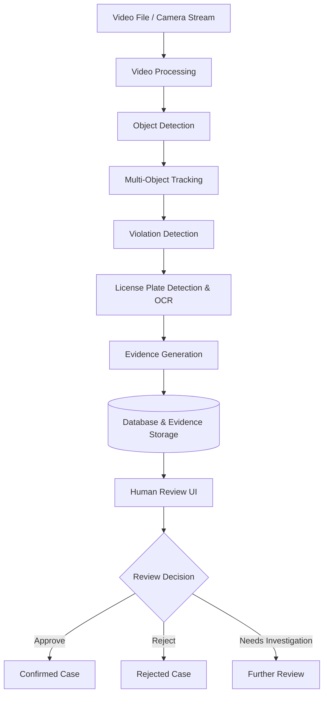

# Traffic Violation Detection System

An AI-assisted traffic violation detection system that analyzes road surveillance videos, identifies potential violations, extracts supporting evidence, and presents cases for human review before a final decision is recorded.

> **Project status:** Early development — Phase 1 (baseline). The first implementation step is video reading and exploration in Jupyter notebooks.
>
> **Academic scope:** This is a specialized academic project and an environment for practicing Computer Vision, AI Engineering, and MLOps. It is not an automated traffic enforcement authority.

## Objectives

- Process traffic videos from recorded files first, with support for camera streams considered later.
- Detect and track road users across video frames.
- Identify **potential** traffic violations from object trajectories and scene-specific rules.
- Recognize license plates where the footage quality allows it.
- Store violation candidates, timestamps, and visual evidence for review.
- Provide a simple human-review interface to approve, reject, or request further inspection.
- Evaluate a pretrained-model baseline, then fine-tune selected models and compare results.

## System Overview



The violation detection module is intended to contain independent, scene-specific detection rules (such as red-light running, wrong-way driving, and lane violations). Detection results are **candidates**, not final judgments. The final case status requires human review.

## Development Plan

### Phase 1 — Baseline System

Build an end-to-end working system using pretrained models and rule-based violation detection:

1. Read traffic videos and inspect video metadata and frames.
2. Run pretrained object detection on individual frames.
3. Track vehicles across frames using persistent tracking IDs.
4. Implement and validate initial violation-detection rules.
5. Detect and recognize license plates when applicable.
6. Generate and store evidence with event metadata.
7. Build a minimal backend and human-review interface.
8. Establish quantitative baseline metrics and document limitations.

### Phase 2 — Fine-tuning & Evaluation

1. Collect or select appropriately licensed, representative datasets.
2. Label data and create train/validation/test splits.
3. Fine-tune selected model components where baseline performance is insufficient.
4. Compare fine-tuned components with the baseline on the same held-out test data.
5. Integrate improvements and assess performance, reliability, and resource usage.

### Future Extension — Cloud & MLOps

Once the core pipeline works locally, explore containerization, model versioning, CI/CD, monitoring, and deployment on AWS. Cloud deployment is a learning extension rather than a prerequisite for the baseline.

## Development Approach: Notebook First

The project follows an **experiment → validate → refactor** workflow:

1. Explore one component in a Jupyter notebook.
2. Inspect outputs visually and measure behavior.
3. Record findings, assumptions, and failure cases.
4. Extract stable logic into reusable modules under `src/`.
5. Add unit/integration tests before connecting it to the full pipeline.

### Planned Project Structure

```text
traffic-violation-detection-system/
├── notebooks/
│   ├── 01_video_reader.ipynb
│   ├── 02_frame_preprocessing.ipynb
│   ├── 03_object_detection.ipynb
│   ├── 04_object_tracking.ipynb
│   ├── 05_violation_detection.ipynb
│   ├── 06_license_plate_recognition.ipynb
│   └── 07_baseline_pipeline.ipynb
├── data/
│   └── raw/                   # Local sample videos; do not commit sensitive footage
├── src/                       # Reusable modules after notebook experiments
├── tests/                     # Unit and integration tests
├── docs/                      # Methodology, architecture, and experiments
└── README.md
```

*This is the target layout; not every file or directory exists yet.*

## Getting Started — First Video Reader Experiment

Requirements: Python 3.11+ (recommended), a Jupyter environment, and a sample traffic video that you are permitted to use.

```bash
# Clone your repository, then enter it
# git clone <your-repository-url>
cd traffic-violation-detection-system

# Create a virtual environment (macOS/Linux)
python3 -m venv .venv
source .venv/bin/activate

# Install the initial notebook dependencies
python -m pip install --upgrade pip
python -m pip install jupyter opencv-python matplotlib numpy

# Start Jupyter
jupyter notebook
```

On Windows, activate the environment with `.venv\Scripts\activate` (PowerShell: `.venv\Scripts\Activate.ps1`).

Place a permitted test video at `data/raw/traffic_sample.mp4`, and create/open `notebooks/01_video_reader.ipynb`.

Initial experiment:

```python
from pathlib import Path
import cv2

video_path = Path("../data/raw/traffic_sample.mp4")
assert video_path.is_file(), f"Video not found: {video_path}"

capture = cv2.VideoCapture(str(video_path))
try:
    if not capture.isOpened():
        raise RuntimeError(f"Cannot open video: {video_path}")

    success, frame = capture.read()
    if not success:
        raise RuntimeError("Could not read the first frame")

    print("Frame shape:", frame.shape)
    print("Frame dtype:", frame.dtype)
finally:
    capture.release()
```

The first notebook should establish how to open a video, read frames, display a sample, inspect FPS/resolution/frame count, and handle end-of-file and invalid inputs.

## Candidate Technologies

| Area | Initial direction |
| --- | --- |
| Language | Python |
| Video processing | OpenCV, FFmpeg (when needed) |
| Object detection | Pretrained YOLO-family model (to be selected) |
| Multi-object tracking | ByteTrack or BoT-SORT (to be evaluated) |
| Violation detection | Rule-based logic using tracked trajectories and scene context |
| License plate recognition | Plate detection + OCR (to be evaluated) |
| API/backend | FastAPI (planned) |
| Database | PostgreSQL (planned) |
| Review interface | Minimal web UI (planned) |
| Experimentation | Jupyter Notebook |
| Cloud/MLOps | AWS and MLOps tools (future extension) |

These are working candidates, not final technology decisions.

## Evaluation

The baseline and fine-tuned system will be evaluated at both component and system levels:

- **Object detection:** precision, recall, and mAP.
- **Tracking:** ID stability, ID switches, and appropriate MOT metrics.
- **License plate recognition:** character/plate-level accuracy on legible plates.
- **Violation detection:** event-level precision and recall, false positives/negatives.
- **End-to-end pipeline:** processing throughput, latency, and evidence completeness.

Dataset quality, camera placement, traffic-rule definitions, and test methodology will be documented to make results reproducible.

## Responsible Use

- Treat automated detections as **reviewable alerts**, not legally binding conclusions.
- Require human verification before confirming a violation.
- Minimize access to footage and personally identifiable data, including license plates.
- Use videos and datasets only when collection, usage, and retention are authorized.
- Expect errors caused by occlusion, lighting, weather, camera angle, and OCR uncertainty.

## Current Milestone

**Phase 1 / Step 1: Video Processing → Video Reader**

- [ ] Open a local video file.
- [ ] Inspect FPS, resolution, duration, and frame count.
- [ ] Read and visualize frames.
- [ ] Explore timestamps and frame sampling.
- [ ] Document observations and edge cases.
- [ ] Refactor the validated reader into a reusable module.

## License

License to be determined. Until a license is added, no open-source reuse rights are granted by default.
